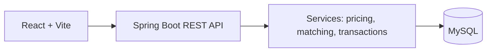

# KrishiLink

KrishiLink is an agricultural marketplace that gives farmers transparent
mandi prices and connects verified supply with buyer demand.

The repository contains a Spring Boot backend and a React/Vite frontend.

## What works

- JWT and bcrypt authentication with role-protected Farmer, Buyer, FPO, and Admin dashboards
- Farmer lots with quality, buyer demands, explainable matching, offers, and safe offer acceptance
- Transaction lifecycle with logistics and payment status updates
- Mandi comparison, 30-day trend statistics, and rule-based selling insight
- MySQL persistence and a responsive React UI backed by REST APIs

## Architecture

## Run locally

1. Install Java 21, Maven, MySQL, and Node.js.
2. Configure the database and JWT settings in
   `backend-spring/src/main/resources/application-local.properties`.
3. From this root, run `npm install` and `npm --prefix frontend install`.
4. Run `npm run dev` to start the Spring Boot backend and Vite frontend.
5. Open `http://localhost:5173`.

## Main API endpoints

| Method | Endpoint | Purpose |
|---|---|---|
| POST | `/api/auth/register`, `/login` | Auth |
| GET/POST | `/api/lots` | Browse / create lots |
| GET | `/api/prices`, `/api/prices/trends`, `/api/markets` | Market intelligence |
| GET/POST | `/api/demands` | Buyer demand |
| GET | `/api/matches/:demandId` | Explainable recommendations |
| GET/POST | `/api/offers` | Offers |
| PATCH | `/api/offers/:id/accept` | Reserve stock and create transaction |
| GET/PATCH | `/api/transactions`, `/api/payments/:transactionId` | Lifecycle and payment |

All responses use `{ success, message, data }`. Protected endpoints require an
`Authorization: Bearer <token>` header.

## Matching and price intelligence

Matching is transparent: commodity 25%, quantity 20%, quality 20%, location
15%, price 15%, and deadline 5%. Price intelligence calculates current, 7/30
day averages, min/max, percentage change, and an UP/DOWN/STABLE trend. Selling
insights are rule-based market guidance, not financial advice or a guaranteed
prediction.
