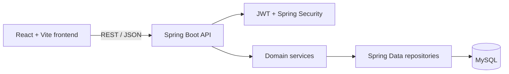

# KrishiLink

KrishiLink is a full-stack agricultural marketplace for connecting farmers,
buyers, FPOs, logistics providers, and administrators. The platform combines
transparent mandi pricing, lot and demand management, explainable matching,
offers, transactions, payments, verification, and operational dashboards.

This repository contains the current application:

- **Backend:** Java 21, Spring Boot 3.3, Spring MVC, Spring Data JPA, Spring Security, JWT, and MySQL
- **Frontend:** React 18, Vite, React Router, Axios, Recharts, Leaflet, and Lucide
- **Build tools:** Maven for the backend and npm for the frontend

## Features

### Marketplace workflows

- Farmer lot creation and quality details
- Buyer demand creation and management
- Explainable lot-to-demand matching
- Offer creation, acceptance, rejection, and status tracking
- Transaction lifecycle and payment status management
- Logistics and storage views
- Dispute and notification management

### Identity and administration

- JWT-based authentication
- Role-based access for Farmer, Buyer, FPO, and Admin users
- Password hashing with BCrypt
- User profiles and role-specific dashboards
- KYC OTP workflow
- Admin user verification and platform statistics

### Market intelligence

- Mandi and commodity price browsing
- Price trends and opportunity analysis
- Rule-based selling advice
- Prediction and analytics views
- Admin market-price synchronization screens
- Interactive mandi maps and charts

The price and selling guidance features are informational and are not financial
advice or guaranteed predictions.

## Architecture



The frontend runs on port `5173` during development. The backend runs on port
`5000` by default. The frontend uses Axios to call the backend under the
`/api` prefix and sends the JWT in the `Authorization: Bearer <token>` header
for protected requests.

## Repository structure

```text
.
├── backend-spring/
│   ├── pom.xml
│   └── src/main/
│       ├── java/com/krishilink/
│       │   ├── config/          Application and security configuration
│       │   ├── controller/      REST endpoints
│       │   ├── dto/             Request and response DTOs
│       │   ├── entity/          JPA entities
│       │   ├── enums/           Domain status and role enums
│       │   ├── exception/       API exceptions and global handler
│       │   ├── repository/      Spring Data repositories
│       │   ├── security/        JWT and user security components
│       │   ├── service/         Business logic
│       │   └── util/            Shared utilities
│       └── resources/
│           ├── application.properties
│           ├── application-local.properties
│           └── application-prod.properties
├── frontend/
│   ├── package.json
│   ├── vite.config.js
│   └── src/
│       ├── api/                 Axios API client
│       ├── components/          Reusable UI components
│       ├── context/             Authentication and language state
│       ├── data/                Frontend data/configuration
│       ├── i18n/                Translations
│       ├── pages/               Route-level screens
│       ├── services/            Frontend service modules
│       └── utils/               Frontend utilities
├── package.json                 Root development scripts
├── pom.xml                      Maven parent project
└── README.md
```

Generated directories such as `frontend/node_modules`, `frontend/dist`, and
`backend-spring/target` are intentionally excluded from version control.

## Prerequisites

Install the following before starting development:

| Tool | Version |
|---|---|
| Java | 21 or newer |
| Maven | 3.9 or newer, or use the Maven Wrapper in `backend-spring/` |
| Node.js | 18 or newer |
| npm | Included with Node.js |
| MySQL | 8.0 or newer |

Verify the installations:

```powershell
java -version
mvn -version
node --version
npm --version
mysql --version
```

## Local setup

### 1. Clone the repository

```powershell
git clone https://github.com/anivartak16/krishilink-platform.git
cd krishilink-platform
```

### 2. Create the MySQL database

Create a local database and user, or use an existing MySQL installation:

```sql
CREATE DATABASE krishilink CHARACTER SET utf8mb4 COLLATE utf8mb4_unicode_ci;
```

The local profile uses:

```text
Host: localhost
Port: 3306
Database: krishilink
Username: root
```

Change the username and password in
`backend-spring/src/main/resources/application-local.properties` when needed.
Hibernate is configured with `ddl-auto=update` for local development, so the
application creates and updates mapped tables as it starts.

### 3. Configure the frontend

Create `frontend/.env` from the example file:

```powershell
Copy-Item frontend\.env.example frontend\.env
```

Set the API URL:

```dotenv
VITE_API_URL=http://localhost:5000/api
```

Do not commit `frontend/.env`. Keep private API keys and service credentials in
environment variables or a managed secret store.

### 4. Install dependencies

Install the root script dependency and frontend dependencies:

```powershell
npm install
npm --prefix frontend install
```

### 5. Start the application

Start both services from the repository root:

```powershell
npm run dev
```

Or start them separately:

```powershell
# Terminal 1 - Spring Boot backend
npm run server

# Terminal 2 - React/Vite frontend
npm run client
```

Open the frontend at <http://localhost:5173>. The backend health endpoint is
available at <http://localhost:5000/api/health>.

## Available scripts

### Root scripts

| Command | Description |
|---|---|
| `npm run dev` | Start backend and frontend concurrently |
| `npm run server` | Start Spring Boot with Maven |
| `npm run server:spring` | Alias for `npm run server` |
| `npm run client` | Start the Vite development server |
| `npm run build:spring` | Build the Spring Boot package without tests |

### Frontend scripts

Run these from the repository root with `npm --prefix frontend`:

| Command | Description |
|---|---|
| `npm --prefix frontend run dev` | Start Vite development server |
| `npm --prefix frontend run build` | Create a production frontend build in `frontend/dist` |

### Maven commands

The Maven Wrapper can be used when Maven is not installed:

```powershell
cd backend-spring
.\mvnw.cmd spring-boot:run
.\mvnw.cmd clean package
```

## Configuration

### Spring profiles

The active profile is controlled by `SPRING_PROFILES_ACTIVE` and defaults to
`local`:

```powershell
$env:SPRING_PROFILES_ACTIVE = "local"
```

Production:

```powershell
$env:SPRING_PROFILES_ACTIVE = "prod"
```

### Backend settings

The production profile supports environment variables for deployment:

| Variable | Purpose |
|---|---|
| `SPRING_PROFILES_ACTIVE` | Spring profile, normally `prod` |
| `PORT` | HTTP port supplied by the hosting platform |
| `DB_URL` or `MYSQL_URL` | MySQL JDBC connection URL |
| `DB_USERNAME` | Database username |
| `DB_PASSWORD` | Database password |
| `DDL_AUTO` | Hibernate schema mode; use a deliberate value in production |
| `JWT_SECRET` | Strong private signing secret |
| `JWT_EXPIRATION` | JWT lifetime in milliseconds |
| `CLIENT_URL` | Primary frontend origin for CORS |
| `DB_POOL_MAX` | Maximum HikariCP pool size |
| `DB_POOL_MIN_IDLE` | Minimum idle HikariCP connections |

Never use a sample or development JWT secret in production. Prefer injecting
all credentials through the hosting platform's secret manager.

### Frontend settings

| Variable | Purpose |
|---|---|
| `VITE_API_URL` | Backend API base URL, including `/api` |
| `GEMINI_API_KEY` | Optional external AI integration key, if enabled |

Vite exposes variables prefixed with `VITE_` to browser code. Do not put
server-only secrets in a `VITE_` variable.

## REST API

The API returns JSON responses in the form:

```json
{
  "success": true,
  "message": "Request completed",
  "data": {}
}
```

Some endpoints return a collection or domain-specific payload in `data`.
Protected routes require:

```http
Authorization: Bearer <jwt-token>
```

### Health and authentication

| Method | Endpoint | Description |
|---|---|---|
| `GET` | `/api/health` | Service health check |
| `POST` | `/api/auth/register` | Register a user |
| `POST` | `/api/auth/login` | Authenticate and receive a JWT |
| `POST` | `/api/auth/logout` | Log out the current session |
| `GET` | `/api/auth/me` | Get the current user |
| `PUT` | `/api/auth/profile` | Update the current profile |
| `GET` | `/api/auth/profile/{id}` | Read a user profile |
| `POST` | `/api/auth/kyc/otp` | Start KYC OTP verification |
| `POST` | `/api/auth/kyc/resend-otp` | Resend KYC OTP |
| `POST` | `/api/auth/kyc/verify-otp` | Verify KYC OTP |

### Marketplace and operations

| Resource | Available operations |
|---|---|
| `/api/lots` | List, read, create, update, and delete lots |
| `/api/demands` | List, read, create, update, and delete demands |
| `/api/matches/{demandId}` | Get explainable matches for a demand |
| `/api/offers` | List, read, create, accept, reject, and update offers |
| `/api/transactions` | List, read, and update transaction status |
| `/api/payments` | List, read, create, and update payments |
| `/api/disputes` | List, create, and update disputes |
| `/api/logistics` | Read logistics data |
| `/api/storage` | Read storage data |
| `/api/notifications` | List notifications and mark them read |
| `/api/chat` | Submit chatbot requests |

### Dashboards and market data

| Resource | Description |
|---|---|
| `/api/dashboard` | Role-specific dashboard data |
| `/api/buyers` | Buyer data |
| `/api/fpo/lots` | FPO lot aggregation data |
| `/api/admin/users` | Admin user administration |
| `/api/admin/users/{id}/verify` | Verify a user |
| `/api/admin/stats` | Admin platform statistics |
| `/api/markets` | Market list and market details |
| `/api/prices` | Current price data |
| `/api/prices/trends` | Historical price trends |
| `/api/prices/opportunity` | Price opportunity data |
| `/api/prices/advice` | Rule-based selling advice |
| `/api/marketPrice` | Market-price integration endpoints |
| `/api/predictions` | Price prediction and analytics data |

For request bodies and role requirements, refer to the corresponding controller
and DTO under `backend-spring/src/main/java/com/krishilink/`.

## Data model

The backend uses JPA entities for the main marketplace concepts:

- `User`
- `Lot`
- `Demand`
- `Offer`
- `Transaction`
- `Payment`
- `Market`
- `MarketPrice`
- `Quality`
- `Warehouse`
- `LogisticsProvider`
- `KycSession`
- `Dispute`
- `Notification`

Repositories provide persistence access, services contain business rules, and
controllers expose the REST API. This separation keeps HTTP concerns out of
the domain and persistence layers.

## Production build and deployment

Build the frontend:

```powershell
npm --prefix frontend run build
```

Build the backend:

```powershell
npm run build:spring
```

The backend artifact is generated under
`backend-spring/target/`. Run it with a production profile:

```powershell
java -jar backend-spring\target\krishilink-backend-1.0.0-SNAPSHOT.jar `
  --spring.profiles.active=prod
```

For deployment:

1. Provision a managed MySQL database.
2. Configure the production environment variables listed above.
3. Set `SPRING_PROFILES_ACTIVE=prod`.
4. Build and deploy the Spring Boot JAR.
5. Deploy the contents of `frontend/dist` to a static hosting provider.
6. Set `VITE_API_URL` to the deployed backend URL before building the frontend.
7. Set `CLIENT_URL` to the deployed frontend origin and verify CORS.

Do not commit database files, compiled artifacts, `.env` files, private keys,
JWT secrets, or API keys.

## Troubleshooting

### Frontend cannot reach the backend

Confirm that the backend is running on port `5000` and that
`frontend/.env` contains:

```dotenv
VITE_API_URL=http://localhost:5000/api
```

Restart Vite after changing an environment file.

### MySQL connection fails

Check that MySQL is running, the `krishilink` database exists, and the
username/password in the active Spring profile are correct. Also verify that
port `3306` is not blocked by another service.

### CORS errors

Add the frontend origin to `krishilink.cors.allowed-origins` in the active
profile. For local development, the default profile allows the Vite origins.

### Port already in use

Change `server.port` or stop the process using port `5000`. Vite can be
started on another port with its standard CLI options.

### Clean generated output

```powershell
Remove-Item frontend\dist -Recurse -Force -ErrorAction SilentlyContinue
Remove-Item backend-spring\target -Recurse -Force -ErrorAction SilentlyContinue
```

## Development guidelines

- Keep credentials in local environment configuration, never in source control.
- Put request/response shapes in DTOs rather than exposing entities directly.
- Keep business rules in services and persistence operations in repositories.
- Update the relevant frontend API client when backend routes change.
- Run the frontend build and backend package build before opening a pull request.
- Avoid committing generated directories and local database files.

## License

No license has been declared for this repository yet. Add an explicit license
before distributing the project outside the owning organization.
