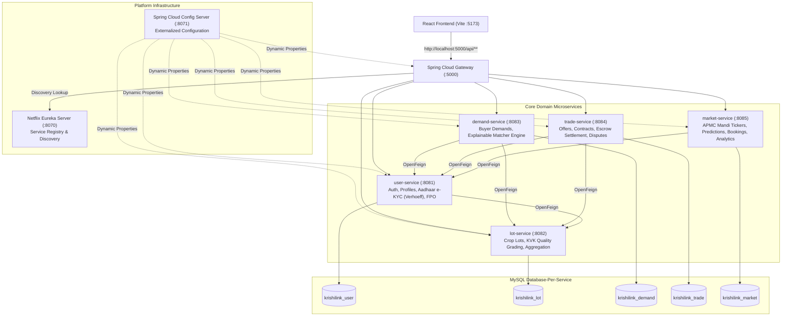

# 🌾 KrishiLink Platform

KrishiLink is an enterprise-grade agricultural trading and intelligence platform connecting Farmers, Buyers, Farmer Producer Organizations (FPOs), Krishi Vigyan Kendra (KVK) quality inspectors, and administrators. The platform pairs real-time APMC Mandi price discovery and AI price forecasting with verified produce lot listings, explainable matching algorithms, offer negotiations, and escrow-secured trade settlements.

---

## 🏛️ Architecture Overview

The repository provides two deployment architectures:
1. **🚀 Microservices Architecture (Spring Cloud / EazyBytes Pattern)** located in [`microservices/`](microservices/) — Multi-module Maven project implementing Service Discovery (Netflix Eureka), Centralized Config Server, Reactive Spring Cloud Gateway, OpenFeign inter-service communication, and isolated MySQL database-per-service.
2. **🏢 Monolithic Architecture** located in [`backend-spring/`](backend-spring/) — Self-contained Spring Boot 3.3.4 application preserved for unified single-instance deployment and baseline verification.
3. **⚛️ Single-Page React Application** located in [`frontend/`](frontend/) — React 18 + Vite frontend with zero-code-change compatibility across both architectures (targeting Gateway/Backend on port `5000`).

---

### Microservices Topology (EazyBytes Cloud Architecture)



---

## 📦 Microservices Service Catalog & Ports

| Service Module | Port | Key Responsibilities & Features | Database |
| :--- | :--- | :--- | :--- |
| **[`eureka-server`](microservices/eureka-server)** | `8070` | Netflix Eureka Service Registry & live heartbeat monitoring dashboard (`http://localhost:8070`) | — |
| **[`config-server`](microservices/config-server)** | `8071` | Spring Cloud Config Server providing externalized, environment-specific configurations | — |
| **[`gateway-server`](microservices/gateway-server)** | `5000` | Reactive API perimeter routing with dynamic DiscoveryLocator, Global CORS, and Actuator probes | — |
| **[`user-service`](microservices/user-service)** | `8081` | JWT Auth, Aadhaar e-KYC with Verhoeff checksum algorithm, Farmer/Buyer profiles, FPO memberships | `krishilink_user` |
| **[`lot-service`](microservices/lot-service)** | `8082` | Crop listings, KVK inspector quality grades (moisture, foreign matter), FPO bulk lot aggregation | `krishilink_lot` |
| **[`demand-service`](microservices/demand-service)** | `8083` | Buyer procurement requests, multi-factor explainable matching engine (quantity, price, quality, location) | `krishilink_demand` |
| **[`trade-service`](microservices/trade-service)** | `8084` | Offer negotiations, binding trade contracts, simulated escrow payments, dispute resolutions | `krishilink_trade` |
| **[`market-service`](microservices/market-service)** | `8085` | Mandi tickers, MSP arbitrage alerts, 14-day price predictions, warehouse/logistics bookings, stats | `krishilink_market` |

---

## 🚀 Quick Start Guide

### Prerequisites
- **Java**: JDK 21 or newer
- **Maven**: 3.9+
- **Node.js**: 18+ & npm
- **Docker & Docker Compose**: (Optional, for containerized execution)
- **MySQL**: 8.0+ (running locally on port `3306` with user `root` and password `root` or configured via env)

---

### Option 1: Running with Docker Compose (Recommended)

Orchestrate the entire platform (MySQL, Eureka Discovery, Config Server, Gateway, 5 Microservices, and Network) in one command:

```powershell
cd microservices
docker compose up --build
```

Access the platform:
- **Eureka Dashboard**: <http://localhost:8070>
- **Spring Cloud Gateway**: <http://localhost:5000>
- **Health Check Probe**: <http://localhost:5000/api/health>

---

### Option 2: Running Microservices Locally via Maven

#### 1. Compile all microservice modules
```powershell
cd microservices
mvn clean package -DskipTests
```

#### 2. Start Core Infrastructure Services
```powershell
# Terminal 1: Service Discovery
cd eureka-server
mvn spring-boot:run

# Terminal 2: Configuration Server
cd config-server
mvn spring-boot:run
```

#### 3. Start Domain Microservices
```powershell
# Terminal 3: User Service
cd user-service; mvn spring-boot:run

# Terminal 4: Produce Lot Service
cd lot-service; mvn spring-boot:run

# Terminal 5: Demand & Matching Service
cd demand-service; mvn spring-boot:run

# Terminal 6: Trade & Escrow Service
cd trade-service; mvn spring-boot:run

# Terminal 7: Market Intelligence & Operations Service
cd market-service; mvn spring-boot:run
```

#### 4. Start Gateway Server
```powershell
# Terminal 8: API Gateway
cd gateway-server; mvn spring-boot:run
```

---

### Option 3: Running the Monolithic Backend (Fallback)

If you wish to run the unified single-instance monolithic backend instead:

```powershell
cd backend-spring
mvn clean spring-boot:run
```

The `local` profile reads `DB_PASSWORD` (defaults to `root`) and `JWT_SECRET` (defaults to a development-only key). The `prod` profile has no fallback for `DB_PASSWORD` or `JWT_SECRET`, so both must be set (plus `DB_URL`, `DB_USERNAME` and `CLIENT_URL` as needed).

---

### ⚛️ Starting the React Frontend

The frontend connects to `http://localhost:5000/api` identically whether backed by the Microservices Gateway or the Monolith:

```powershell
# Install frontend dependencies
npm --prefix frontend install

# Start Vite development server
npm --prefix frontend run dev
```

Open your browser at **<http://localhost:5173>**.

---

## 🗄️ Monolith Schema Migrations (Flyway)

The monolith's schema lives in `backend-spring/src/main/resources/db/migration` and is applied by Flyway on startup; Hibernate runs with `ddl-auto=validate` and never alters tables.

- A new, empty database gets every migration from `V1__baseline_schema.sql`.
- An existing database created earlier by `ddl-auto=update` is baselined at V1 and only receives later migrations (e.g. `V2` converts offer, transaction and payment amounts to `DECIMAL(14,2)`).
- Schema changes go in a new `V<n>__description.sql` file; never edit an applied migration.

## 📬 Trade Events (Outbox) and Payment Idempotency

- **Outbox:** offer placement, FPO proposals, offer acceptance and payment write a row to `outbox_events` in the same database transaction as the trade change. `OutboxRelay` polls pending rows (every 2s, `krishilink.outbox.poll-interval-ms`), creates the notification and marks the row published in one transaction. A rolled-back trade leaves no event; a failing event is retried up to `krishilink.outbox.max-attempts` (default 5) and keeps its last error.
- **Idempotency-Key:** `POST /api/payments` and `POST /api/payments/{transactionId}/process` accept an optional `Idempotency-Key` header. A retry with the same key and body returns the stored response with `Idempotent-Replayed: true`; the same key with a different transaction or body returns `422`. Keys are scoped per user and purged after `krishilink.idempotency.ttl-hours` (default 24).

---

## 🛡️ Database Architecture (Database-Per-Service)

For microservices, isolated database schemas are created automatically on MySQL via JDBC `createDatabaseIfNotExist=true`:

```sql
CREATE DATABASE IF NOT EXISTS krishilink_user CHARACTER SET utf8mb4 COLLATE utf8mb4_unicode_ci;
CREATE DATABASE IF NOT EXISTS krishilink_lot CHARACTER SET utf8mb4 COLLATE utf8mb4_unicode_ci;
CREATE DATABASE IF NOT EXISTS krishilink_demand CHARACTER SET utf8mb4 COLLATE utf8mb4_unicode_ci;
CREATE DATABASE IF NOT EXISTS krishilink_trade CHARACTER SET utf8mb4 COLLATE utf8mb4_unicode_ci;
CREATE DATABASE IF NOT EXISTS krishilink_market CHARACTER SET utf8mb4 COLLATE utf8mb4_unicode_ci;
```

---

## 🔑 Demo Credentials

With the `local` profile the platform seeds these demo users across all roles. The `prod` profile skips them unless `SEED_DEMO_DATA=true`, because the password is public:

| Role | Email | Password | Sample Activities |
| :--- | :--- | :--- | :--- |
| **Farmer** | `farmer@krishilink.com` | `Demo@12345` | List produce lots, request KVK quality verification, accept buyer offers |
| **Buyer** | `buyer@krishilink.com` | `Demo@12345` | Create procurement demands, view explainable matches, make offers, pay into escrow |
| **FPO** | `fpo@krishilink.com` | `Demo@12345` | Manage farmer members, certify field e-KYC, aggregate produce into bulk lots |
| **KVK Inspector**| `kvk@krishilink.com` | `Demo@12345` | Inspect crop quality, issue Grade A/B/C ratings, record moisture & foreign matter |
| **Admin** | `admin@krishilink.com` | `Demo@12345` | System oversight, verify users, sync daily AGMARKNET mandi rates, resolve disputes |

---

## 📡 Gateway API Route Mappings

All requests from the frontend enter through the Spring Cloud Gateway at port `5000`:

| Inbound Path | Destination Microservice | Purpose |
| :--- | :--- | :--- |
| `/api/auth/**` | `USER-SERVICE` | Authentication, register, login, session, e-KYC OTP |
| `/api/users/**` | `USER-SERVICE` | User profiles, internal inter-service user lookup |
| `/api/buyers/**` | `USER-SERVICE` | Buyer directory and enterprise procurement profiles |
| `/api/fpo/**` | `USER-SERVICE` | FPO cluster members, member verification, Feign lot pooling |
| `/api/lots/**` | `LOT-SERVICE` | Marketplace crop listings, publishing, quality tests |
| `/api/inspections/**` | `LOT-SERVICE` | KVK inspector queue and quality grading |
| `/api/demands/**` | `DEMAND-SERVICE` | Buyer procurement demands |
| `/api/matches/**` | `DEMAND-SERVICE` | Explainable match scoring against active lots |
| `/api/offers/**` | `TRADE-SERVICE` | Counter-offers, accept, reject, and contract generation |
| `/api/transactions/**` | `TRADE-SERVICE` | Transaction status lifecycle management |
| `/api/payments/**` | `TRADE-SERVICE` | Escrow deposits, payment status, settlement processing |
| `/api/disputes/**` | `TRADE-SERVICE` | Trade dispute arbitration and ticket resolution |
| `/api/prices/**` | `MARKET-SERVICE` | Price trends, MSP opportunity arbitrage alerts, sell advice |
| `/api/marketPrice/**` | `MARKET-SERVICE` | AGMARKNET daily mandi price import & sync |
| `/api/markets/**` | `MARKET-SERVICE` | Mandi locator, geospatial distance, and transport estimates |
| `/api/predictions/**` | `MARKET-SERVICE` | 14-day price forecasting with confidence bounds |
| `/api/storage/**` | `MARKET-SERVICE` | Warehouse cold storage discovery & booking |
| `/api/logistics/**` | `MARKET-SERVICE` | Agri-freight vehicle booking and tracking |
| `/api/notifications/**` | `MARKET-SERVICE` | Real-time alerts and notification management |
| `/api/dashboard/**` | `MARKET-SERVICE` | Role-based operational dashboards and metrics |
| `/api/admin/**` | `MARKET-SERVICE` | Cross-service analytics and platform statistics |
| `/api/chat/**` | `MARKET-SERVICE` | Agricultural advisory chatbot service |

---

## 🧪 Testing and Verification

### Run Microservices Test Suite
Execute tests across all 9 reactor modules:
```powershell
mvn --file microservices/pom.xml test
```
*Current Status: 9/9 Modules Passing with 0 Failures, 0 Errors.*

### Run Monolithic Test Suite
```powershell
mvn --file backend-spring/pom.xml test
```
*Current Status: 24/24 Integration Tests Passing.*

### Verify Frontend Production Build
```powershell
npm --prefix frontend run build
```
*Current Status: 2,645 modules compiled with 0 errors.*

---

## 📁 Repository Directory Structure

```text
KrishiLink/
├── microservices/                  # EazyBytes Spring Cloud Microservices
│   ├── pom.xml                     # Parent reactor POM (Spring Boot 3.3.4, Cloud 2023.0.3)
│   ├── docker-compose.yml          # Container orchestration (MySQL, Gateway, Discovery, Services)
│   ├── eureka-server/              # Netflix Eureka Service Discovery (:8070)
│   ├── config-server/              # Spring Cloud Config Server (:8071)
│   ├── gateway-server/             # Spring Cloud Gateway Server (:5000)
│   ├── user-service/               # Identity, Auth, e-KYC, FPO Memberships (:8081)
│   ├── lot-service/                # Crop Lots & Quality Grading (:8082)
│   ├── demand-service/             # Demands & Explainable Matching (:8083)
│   ├── trade-service/              # Offers, Transactions & Escrow Payments (:8084)
│   └── market-service/             # Mandi Intelligence, Predictions & Bookings (:8085)
├── backend-spring/                 # Monolithic Spring Boot Architecture (Preserved & Verified)
├── frontend/                       # React 18 + Vite UI Client (Port :5173)
├── package.json                    # Root npm scripts
└── README.md                       # Comprehensive platform documentation
```

---

## 📄 License
This project is licensed under the MIT License.
